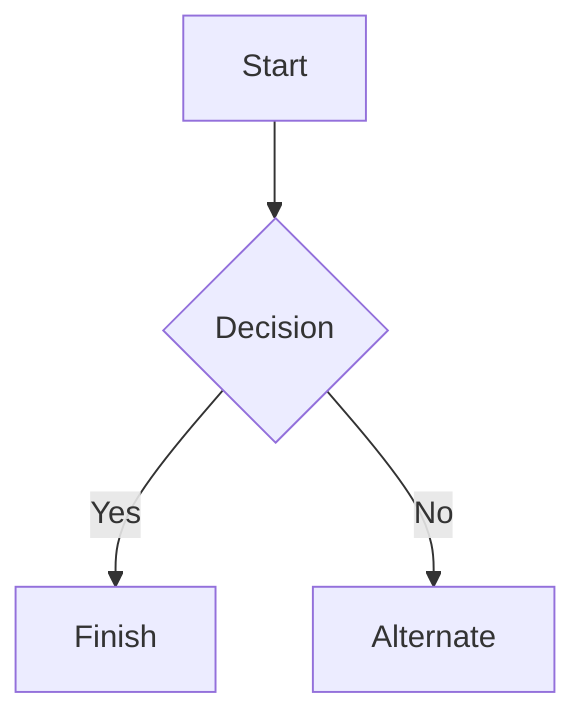

# Azure Application Gateway for Containers (AGC) ALB Deployment on AKS

Azure Application Gateway for Containers is a managed Layer 7 load balancing and ingress service designed specifically for containerized workloads in Azure Kubernetes Service (AKS). It represents the architectural evolution of the older Application Gateway Ingress Controller (AGIC), delivering near-instantaneous configuration updates and offloading data-plane traffic processing completely outside your cluster.

The system relies directly on an ALB Controller (Application Load Balancer Controller), which is an in-cluster operator that translates Kubernetes-native configuration into Azure load-balancing rules


### Step 1 – Export the Azure Cli environment variable in local environment

```
#!/bin/bash
source export-variables.sh
```
### Step 1 – Install ALB Controller using the AKS add-on

```
# Enable Gateway API and ALB during cluster provisioning
--enable-gateway-api
--enable-application-load-balancer
  
# OR Modify the cluster if already provisioned
az aks update --name $CLUSTER_NAME --resource-group $RESOURCE_GROUP --enable-gateway-api --enable-application-load-balancer

# Check the the account status and Resource Providers are enabled 
az account show --output table
az feature list --namespace Microsoft.ContainerService --output table

# Register the required Resource Provider on subscription level
az extension add --name aks-preview --upgrade

az feature register \
  --namespace Microsoft.ContainerService \
  --name ApplicationLoadBalancerPreview

az feature register \
  --namespace Microsoft.ContainerService \
  --name ManagedGatewayAPIPreview

# Verify the Privders 
az feature show \
  --namespace Microsoft.ContainerService \
  --name ApplicationLoadBalancerPreview \
  --query properties.state -o tsv

az feature show \
  --namespace Microsoft.ContainerService \
  --name ManagedGatewayAPIPreview \
  --query properties.state -o tsv

# Output
  Registered
  Registered
  
# When both report Registered
az provider register --namespace Microsoft.ContainerService

# Check the controller
kubectl get pods -n kube-system | grep alb-controller

# Check the GatewayClass
kubectl get gatewayclass
# Output
NAME                 CONTROLLER                               ACCEPTED   AGE
azure-alb-external   alb.networking.azure.io/alb-controller   True       128m

kubectl get gatewayclass azure-alb-external -o yaml
```


### Step 2 – Create AGC managed by ALB Controller

```
# Find the AKS node resource group
MC_RESOURCE_GROUP=$(az aks show \
  -g "$RESOURCE_GROUP" \
  -n "$AKS_NAME" \
  --query nodeResourceGroup -o tsv)

echo "$MC_RESOURCE_GROUP"

# Find the subnet used by your AKS node pool:
CLUSTER_SUBNET_ID=$(az vmss list \
  --resource-group "$MC_RESOURCE_GROUP" \
  --query '[0].virtualMachineProfile.networkProfile.networkInterfaceConfigurations[0].ipConfigurations[0].subnet.id' \
  -o tsv)

echo "$CLUSTER_SUBNET_ID"

# Find Existing VNet
VNET_ID=$(az network vnet subnet show \
  --ids "$CLUSTER_SUBNET_ID" \
  --query id -o tsv | sed 's#/subnets/.*##')

VNET_NAME=$(az network vnet show --ids "$VNET_ID" --query name -o tsv)

VNET_RESOURCE_GROUP=$(az network vnet show \
  --ids "$VNET_ID" --query resourceGroup -o tsv)

echo "$VNET_NAME"
echo "$VNET_RESOURCE_GROUP"

# Create the dedicated subnet
ALB_SUBNET_NAME="snet-agc"
ALB_SUBNET_PREFIX="<unused-vnet-address-range-with-at-least-250-available-ips>"

az network vnet subnet create \
  --resource-group "$VNET_RESOURCE_GROUP" \
  --vnet-name "$VNET_NAME" \
  --name "$ALB_SUBNET_NAME" \
  --address-prefixes "$ALB_SUBNET_PREFIX" \
  --delegations Microsoft.ServiceNetworking/trafficControllers
  
# Get its resource ID
ALB_SUBNET_ID=$(az network vnet subnet show \
  --resource-group "$VNET_RESOURCE_GROUP" \
  --vnet-name "$VNET_NAME" \
  --name "$ALB_SUBNET_NAME" \
  --query id -o tsv)

echo "$ALB_SUBNET_ID"

SUBNET_ID=$(az network vnet subnet show \
    --resource-group rg-flyaway \
    --vnet-name vnet-aks-prod \
    --name snet-agc \
    --query id -o tsv)
# grant the Network Contributor role to the ALB controller's service principal on the subnet
az role assignment create \
    --assignee-object-id 68cef9c2-6e3d-4eca-a38f-cd9f78759e2b \
    --assignee-principal-type ServicePrincipal \
    --role "Network Contributor" \
    --scope "$SUBNET_ID"

kubectl rollout restart deployment alb-controller -n kube-system

kubectl create namespace alb-infra

# Create application load balanacer manifest
cat > application-load-balancer.yaml <<EOF
apiVersion: alb.networking.azure.io/v1
kind: ApplicationLoadBalancer
metadata:
  name: flyaway-alb
  namespace: alb-infra
spec:
  associations:
    - ${ALB_SUBNET_ID}
EOF

kubectl apply -f application-load-balancer.yaml

# wait for response
kubectl get applicationloadbalancer flyaway-alb \
  -n alb-infra -o yaml -w
  # check the status 
  {
    reason: Ready
    status: "True"
    type: Deployment
  }

kubectl get deployments,pods,services -A
kubectl get service appflyaway-ingress-service -n default -o yaml
kubectl get pods -n default --show-labels
```
### Step 3 – Configure HTTPS / TLS offloading
#### We’ll create two listeners:

* HTTP on port 80, to redirect visitors to HTTPS.
* HTTPS on port 443, to terminate TLS and forward requests to FlyAway.

#### Before applying this Gateway, obtain a TLS certificate for flyaway.capclouds.com

```
kubectl create secret tls flyaway-tls \
  --namespace default \
  --cert=fullchain.pem \
  --key=privkey.pem
# Create flyaway-gateway.yaml
apiVersion: gateway.networking.k8s.io/v1
kind: Gateway
metadata:
  name: flyaway-gateway
  namespace: default
  annotations:
    alb.networking.azure.io/alb-namespace: alb-infra
    alb.networking.azure.io/alb-name: flyaway-alb
spec:
  gatewayClassName: azure-alb-external
  listeners:
    - name: http-listener
      hostname: flyaway.capclouds.com
      port: 80
      protocol: HTTP
      allowedRoutes:
        namespaces:
          from: Same

    - name: https-listener
      hostname: flyaway.capclouds.com
      port: 443
      protocol: HTTPS
      tls:
        mode: Terminate
        certificateRefs:
          - kind: Secret
            group: ""
            name: flyaway-tls
      allowedRoutes:
        namespaces:
          from: Same

kubectl apply -f flyaway-gateway.yaml
```
### Step 4 – Configure AGC Web Application Firewall

## Images


## Links

You may be using [Markdown Live Preview](https://markdownlivepreview.com/).

## Blockquotes

> Markdown is a lightweight markup language with plain-text-formatting syntax, created in 2004 by John Gruber with Aaron Swartz.
>
>> Markdown is often used to format readme files, for writing messages in online discussion forums, and to create rich text using a plain text editor.

## Tables

| Left columns  | Right columns |
| ------------- |:-------------:|
| left foo      | right foo     |
| left bar      | right bar     |
| left baz      | right baz     |

## Blocks of code

```
let message = 'Hello world';
alert(message);
```

## Mermaid diagrams


## Inline code

This web site is using `markedjs/marked`.
