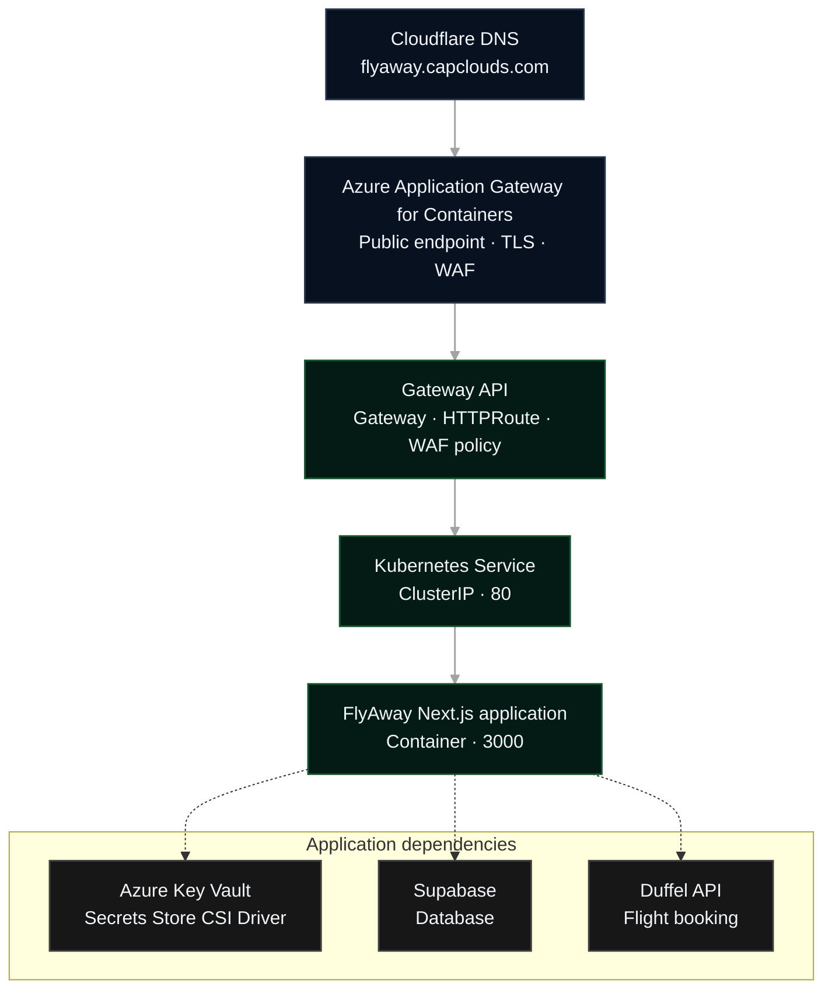

# Azure Application Gateway for Containers (AGC) ALB Deployment on AKS

Azure Application Gateway for Containers is a managed Layer 7 load balancing and ingress service designed specifically for containerized workloads in Azure Kubernetes Service (AKS). It represents the architectural evolution of the older Application Gateway Ingress Controller (AGIC), delivering near-instantaneous configuration updates and offloading data-plane traffic processing completely outside your cluster.

The system relies directly on an ALB Controller (Application Load Balancer Controller), which is an in-cluster operator that translates Kubernetes-native configuration into Azure load-balancing rules


### Step 1 – Export the Azure Cli environment variable in local environment

```
#!/bin/bash
source export-variables.sh
```

### Step 2 – Create AKS Cluster using azure cli 

```
#!/bin/bash
bash aks-cli.sh
```
### Step 3 – Create a Managed Identity with role assignment "Key Vault Secret User"

```
#!/bin/bash
bash managed-identity.sh
```
### Step 4 – Install Application Load Balancer controller per-requisities 

```
#!/bin/bash
bash ALB-cli.sh
```
### Step 5 – Deploy the flyaway Kubernetes application

```
kubectl apply -f service-account.yaml
kubectl apply -f secretProviderClass.yaml
kubectl apply -f deployment.yaml
kubectl apply -f clusterIP-service.yaml
```
### Step 6 – Create Application Gateway Controller and Gateway

```
kubectl apply -f alb-namespace.yaml
kubectl apply -f application-load-balancer.yaml
kubectl apply -f flyaway-gateway.yaml

```

### Step 7 – Create http-route for flyaway service

```
kubectl apply -f flyaway-http-routes.yaml

```
### Step 8 – Create WAF Policy

```
#!/bin/bash
bash waf-policy.sh

```
```
kubectl apply -f flyaway-waf.yaml

```
### Final Ingress Architecture Architecture 
This diagram shows the external request path into the FlyAway application on AKS and the services it depends on.

## Architecture



## Traffic flow

1. **Cloudflare DNS** resolves `flyaway.capclouds.com` to the public AGC frontend.
2. **Azure Application Gateway for Containers (AGC)** provides the public entry point, TLS termination, and WAF protection.
3. **Gateway API** resources define the listener and routing:
   - `Gateway` defines the gateway listener.
   - `HTTPRoute` matches the hostname and forwards requests to the Kubernetes Service.
   - The WAF policy configures the applicable WAF protection.
4. **Kubernetes Service** exposes FlyAway internally using `ClusterIP` on port `80`.
5. **FlyAway Next.js** receives the forwarded traffic on container port `3000`.

## Application dependencies

- **Azure Key Vault + Secrets Store CSI Driver** – provides configured secrets to the AKS workload through the `SecretProviderClass` integration.
- **Supabase** – provides database services.
- **Duffel API** – supports flight search and booking.

The dotted connections represent application integrations; they are not additional inbound ingress hops.

## Ports

| Component | Port | Purpose |
|---|---:|---|
| AGC | 443 | Public HTTPS listener |
| Kubernetes Service | 80 | Internal service port |
| FlyAway container | 3000 | Next.js application port |
