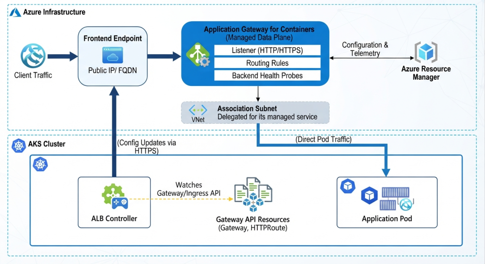
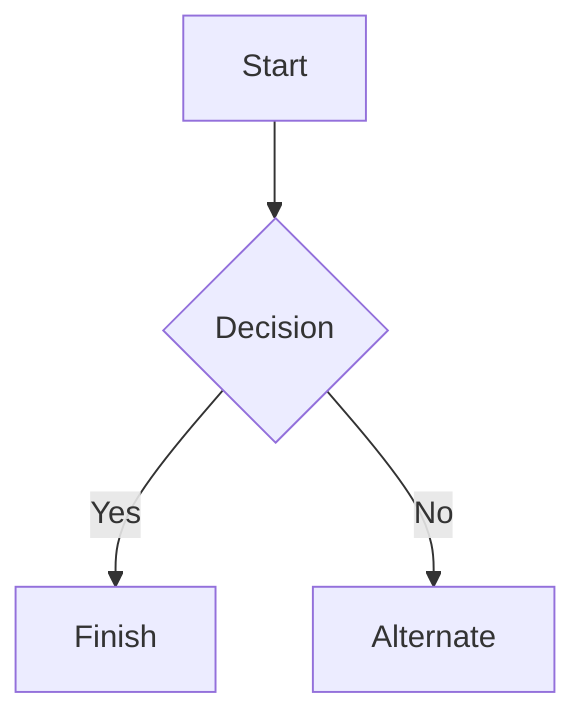

# Azure Application Gateway for Containers (AGC) ALB Deployment on AKS

Azure Application Gateway for Containers is a managed Layer 7 load balancing and ingress service designed specifically for containerized workloads in Azure Kubernetes Service (AKS). It represents the architectural evolution of the older Application Gateway Ingress Controller (AGIC), delivering near-instantaneous configuration updates and offloading data-plane traffic processing completely outside your cluster.

The system relies directly on an ALB Controller (Application Load Balancer Controller), which is an in-cluster operator that translates Kubernetes-native configuration into Azure load-balancing rules

## Images



### Step 1 – Install ALB Controller using the AKS add-on
## Blocks of code

```
let message = 'Hello world';
alert(message);
```

### Step 2 – Create AGC managed by ALB Controller
### Step 3 – Configure HTTPS / TLS offloading
### Step 4 – Configure AGC Web Application Firewall

## Images


## Links

You may be using [Markdown Live Preview](https://markdownlivepreview.com/).

## Blockquotes

> Markdown is a lightweight markup language with plain-text-formatting syntax, created in 2004 by John Gruber with Aaron Swartz.
>
>> Markdown is often used to format readme files, for writing messages in online discussion forums, and to create rich text using a plain text editor.

## Tables

| Left columns  | Right columns |
| ------------- |:-------------:|
| left foo      | right foo     |
| left bar      | right bar     |
| left baz      | right baz     |

## Blocks of code

```
let message = 'Hello world';
alert(message);
```

## Mermaid diagrams


## Inline code

This web site is using `markedjs/marked`.
