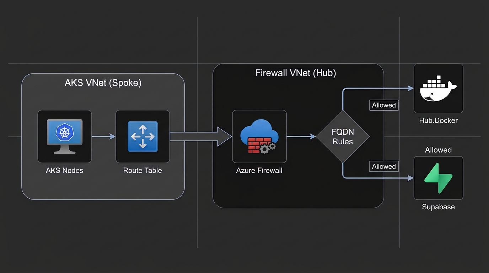

### Configure AKS with Azure Firewall for Egress Traffic Filtering

Standard AKS deployments allow unrestricted outbound internet traffic from all pods. To meet strict security and compliance standards, you must monitor and restrict these external connections. Azure Firewall provides this control by acting as a centralized egress point where you can enforce FQDN-based allowlists. In this guide, you will learn how to route AKS egress through Azure Firewall and configure the essential rules the cluster needs to operate successfully.

### Architecture Diagram

